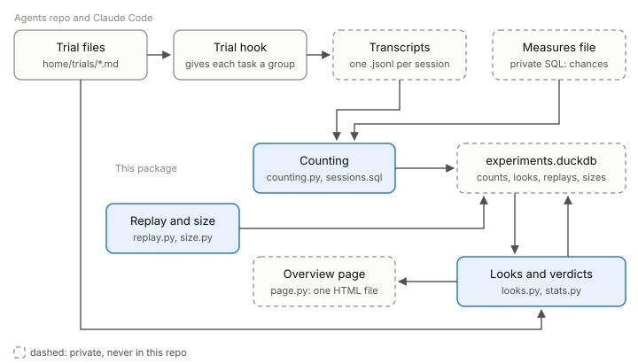

# agent-experiments

Tests whether a change to a coding agent's rules works: the rule is on for a random half of tasks, and each day this tool counts how often each half breaks it, gives a verdict when it can, and draws one page.



It reads Claude Code session transcripts and a measures file you write in SQL, which says what counts as a chance to break a rule and what counts as a miss. Trials come from the [agents repo](https://github.com/ColinCee/agents)'s `home/trials/`, whose hook gives each task its group.

## Start

```
uv run agent-experiments daily --agents-repo <path to the agents repo>
```

It writes `~/.claude/keep-going/experiments.duckdb` and `~/.claude/keep-going/overview.html`; `uv run agent-experiments daily --help` lists the paths it takes.

## Docs

- [Architecture](docs/architecture.md): the parts, the method, and why a week is often too short.
- [AGENTS.md](AGENTS.md): checks and rules for changing it.
