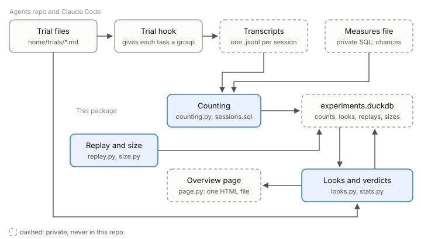

# Architecture

How a rule trial goes from session transcripts to a verdict on one page.



Everything dashed in the picture is the user's own data and stays under `~/.claude/keep-going/` or `~/.claude/projects/`, never in this repository.

## Hook

A trial is a file in the agents repo's `home/trials/` (format: that repo's `docs/keep-going.md`; a file with no `started:` date is reported and skipped). Its hook, at each session and subagent start, puts the rule's `On` or `Off` wording in the session's context and writes one line that lands in the transcript as a `hook_additional_context` attachment:

```
Rule trials: <trial>=on|off ... holdout=yes|no task=<8 hex> rules=<7 hex>
```

The group comes from a hash of the trial's name and the task, so a task keeps its group across restarts and two trials split tasks independently. A `settled` trial is on for every task except the holdout tenth.

## Counting

`counting.py` runs [`sessions.sql`](../src/agent_experiments/sessions.sql) over every transcript, then the measures file, and replaces three tables in the DuckDB file:

| Table | One row per |
|---|---|
| `sessions` | session and day: project, entrypoint, model, effort, replies, typed messages, tokens, root session, stamps |
| `stamps` | stamp the hook gave a session, with its time |
| `chances` | moment a rule could be broken (`measure, session, day, ts, uuid, miss`), as the measures file defines them |

A continued session copies its parent's entries; each counts once, for the root session. A measures file is SQL that creates a temp table `chances` from the temp tables `texts`, `calls` and `typed`; `sessions.sql` names their columns. It may also create `measure_names(measure, name)`, names the page shows in place of measure ids, and `changes(measure, day, what)`, the days a rule for a measure changed. A full rebuild takes about 8 s on 2 GB of transcripts.

`looks` and `replays` are never rebuilt: a look is written once, and a replay's row changes only when that replay is rerun.

## Looks

[`looks.py`](../src/agent_experiments/looks.py) turns chances into tasks per group, then into looks.

- **Unit.** A task is the stamp's `task=` token, else the root session. A session counts for a trial only when every stamp it and its root got agrees on its group, and only its chances after the first stamp that named the trial, so a trial added mid-task does not claim earlier replies. Sessions nobody typed in, or with no stamp, are left out; the page counts the unstamped.
- **When.** A trial is looked at when its smaller group reaches 10, 20 and 40 tasks, and a last time 7 days after `started`, whatever its size. A look is due only past every look already taken under that trial name and `started` date, so a restarted trial starts again; none follows `works` or the last look.
- **Verdict.** An early look says `works` or `no verdict yet`. The last says `works`, `no useful effect` (the 90% range of the drop rules out a 30% drop) or `can't tell`. Fewer than 5 tasks in a group is always `can't tell`.
- **Settled rules.** Holdout tasks against the rest over the last 28 days, on the model with the most replies in the last 7, so a model that no longer needs a rule shows. It is no longer helping when its range rules out a 30% drop.
- **Usual range.** For each measure, the latest day's miss rate against the middle 98% of rates from the same number of tasks drawn from the 28 days before.

## Replays

[`replay.py`](../src/agent_experiments/replay.py) tests a rule's wording in hours: a model writes the agent's next message at past moments under the old and the new rules, and their misses are compared.

- **Moments.** A measure's stored chances in sessions someone typed in. Sessions are taken in random order, each one's first chance and then others, at most 3 per session. The conversation before it becomes text (typed messages, replies, tool calls and how each result began), its last 24,000 characters.
- **Replies.** The Claude Agent SDK for Python, locked in `uv.lock` with the Claude Code it bundles, on the signed-in subscription, six at once, from a child process given only what it needs to run and sign in (`ENV_KEEP`): the framed rules file is the whole system prompt, with no tools, settings, MCP servers or saved session, and one turn, each in a fresh empty folder outside the home folder so no `CLAUDE.md` above it can be read. Claude Code still adds about 600 tokens of its own: the date, the folder, the platform and a note on downloaded files.
- **Runs.** A run's folder is named for the measure and a hash of the framed rules, model, pick settings and how prompts are cut, which its `manifest.json` records, so changed inputs never reuse replies. Replies are saved as they come: a rerun continues (a line cut off by a kill is written again), running out of quota keeps what was written, and `--rescore FOLDER` makes no model calls.
- **Scoring.** Each reply goes through the measures file as the one text of a session of its own, with nothing called or typed, so one definition of a measure counts both real sessions and replays. Only measures on reply text can be replayed.
- **Check.** Under the rules the sessions really had (`--in-force`), the replay must miss within 1.5 times the real rate or within 5 points of it; otherwise the verdict is `replay can't test this`. On the first real replay the agents missed 30% and the replay 10%.
- **Verdict.** Moments where both replies had a chance, compared by session (Method): under 30 is `can't tell`; else `works` at one-sided p < 0.05 with fewer misses under the new rules, `no useful effect` when the 90% range rules out a 30% drop, else `can't tell`. One row per run folder goes in `replays`.

## Rule and skill size

[`size.py`](../src/agent_experiments/size.py) shows whether agents only append to rules and skills. From the agents repo's whole `git log --numstat -M` (so a file moved into a pattern from anywhere is not new) and each file's text at each commit, it fills `sizes`: one row per file a commit changed, with its words after the commit and the lines added and deleted. A file renamed away or deleted drops to 0 words. `daily --agents-repo` refreshes it for `home/*.md`, the every-turn rules, and `skills/*/SKILL.md`. The figures are on the overview page, not here, since they move with every commit.

## Method

[`stats.py`](../src/agent_experiments/stats.py) uses SciPy for both tests.

- **Why tasks.** Misses clump within a task: one agent that ignores a rule ignores it all session. Counting chances as independent would make every trial look sure. So tasks are shuffled between groups and resampled whole, and the rate is a ratio of sums (all misses over all chances in a group), which weights a task by its chances. Counting misses over chances found a real halving 3 to 5 times as often as counting tasks with any miss.
- **p.** `scipy.stats.permutation_test` over task indices, one-sided: the rule's group misses less. Real looks use 99,999 shuffles, since the first limit needs steps of p well below 0.0003.
- **Range.** `scipy.stats.bootstrap`, percentile, 90%: the drop `1 - on/off`, resampling tasks within each group. A resample with no misses without the rule has no drop and is left out.
- **Replays.** The same moments answered under the old and the new wording: shuffles swap the two answers within a session, and the bootstrap draws whole sessions.
- **Limits.** One-sided O'Brien-Fleming-style limits for the three looks: p < 0.0003, 0.0071 and 0.0225. On these sessions they passed a do-nothing rule 3.6% of the time (p < 0.02 at each look: 6%); on made-up tasks, 3.0% in 1,000 runs. `tests/test_stats.py` fails if that rises past 7% in 300.
- **Power.** For each running trial the page shows the tasks per group (10 to 320, doubling) at which one look at 0.0225 finds a true halving 80% of the time, simulated from that measure's tasks over the last 28 days with the rule's group's misses thinned by half. On the user's sessions up to 11 November 2026 it said 20 for the commonest miss, 40 or 80 for four measures and 160 or 320 for four, while a week brings 5 to 19 tasks per group. So a week often cannot decide, and a trial that can't tell gets a commoner measure or a bolder change, not a longer run.

## Overview page

[`page.py`](../src/agent_experiments/page.py) writes one HTML file of about 20 KB with no script, so any viewer shows it: charts are SVG written directly, coloured by the page's light and dark styles. On top, four counts: trials running, recent verdicts, sessions with a group, settled rules no longer helping. Then a card per trial: its day, tasks per group, status, tasks needed, the drop with its 90% range, and folded, its miss rates with and without the rule since the start, looks marked. Folded below:

- **Tracked measures.** Each one's share of chances missed over 3 days for 6 weeks, a line on each day a rule for it changed (`changes`, and each trial's start), and its misses before and after the latest change. Before and after is not a test: whatever else changed that day moves it too, which a trial's random halves rule out.
- **Replays**, and **rule and skill size**: words over time, largest files, and per month and pattern the share of changes deleting no line and of changed lines added.

A trial that fails is left off, and `daily` prints why and exits 1 after writing the page.
