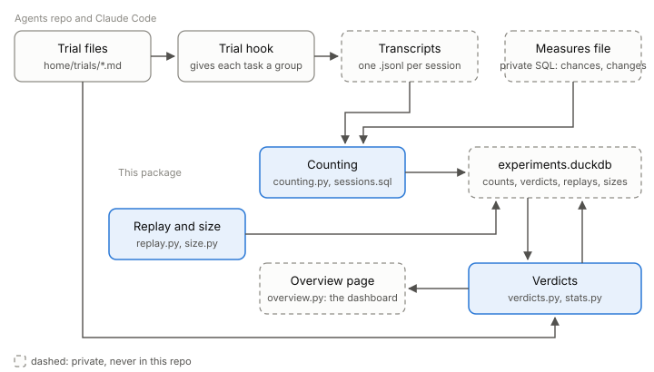

# Architecture

How a rule trial goes from session transcripts to a verdict on one page.



Everything dashed in the picture is the user's own data and stays under `~/.claude/keep-going/` or `~/.claude/projects/`, never in this repository.

## Hook

A trial is a file in the agents repo's `home/trials/` (format: that repo's `docs/keep-going.md`; a file with no `started:` date is reported and skipped). Its hook, at each session and subagent start, puts every trial's `On` wording in the session's context and writes one line that lands in the transcript as a `hook_additional_context` attachment:

```
Rule trials: <trial>=on ... task=<8 hex> rules=<7 hex>
```

The task token keeps a task one unit across restarts. Stamps from before every task got `On` also carry `=off` groups and `holdout=`; nothing reads those now.

## Counting

`counting.py` runs [`sessions.sql`](../src/agent_experiments/sessions.sql) over every transcript, then the measures file, and replaces these tables in the DuckDB file:

| Table | One row per |
|---|---|
| `sessions` | session and day: project, entrypoint, model, effort, replies, typed messages, tokens, root session, stamps |
| `stamps` | stamp the hook gave a session, with its time |
| `chances` | moment a rule could be broken (`measure, session, day, ts, uuid, miss`), as the measures file defines them |
| `skill_loads` | skill an agent loaded, with its version: a hash of the text it read, without its folder or arguments |

A continued session copies its parent's entries; each counts once, for the root session. A measures file is SQL that creates a temp table `chances` from the temp tables `texts`, `calls` and `typed`; `sessions.sql` names their columns. It may also create `measure_names(measure, name)`, names the page shows in place of measure ids, `changes(measure, day, what)`, the days a rule for a measure changed, and `skill_measures(measure, skill)`, the measures that count a skill not loaded when needed, under each name the skill has had. A full rebuild takes about 8 s on 2 GB of transcripts.

`verdicts`, `looks` (the holdout era's, no longer written) and `replays` are never rebuilt: a verdict is written once, and a replay's row changes only when that replay is rerun.

## Verdicts

[`verdicts.py`](../src/agent_experiments/verdicts.py) gives each trial one verdict for each of its measures, from its mistake rate before the change against its first days after.

- **Unit.** A task is the stamp's `task=` token, else the root session. Sessions nobody typed in are left out.
- **When.** On the trial's third day of real use from `started` (`REAL_DAYS`), a day being one someone typed in a session; never later. A settled trial that started before `JUDGED_FROM` had the holdout's verdict and gets none.
- **Sides.** Before: from the measure's earlier rule change in `changes`, or `BEFORE_DAYS` back if later, to the day before `started`; a `changes` row within `OWN_CHANGE` days before `started` dates the trial's own change and is skipped. After: `started` to the verdict day.
- **Verdict.** `works` when the 90% range of the change lies wholly below 0, `worse` when wholly above, each only with `MIN_TASKS` on both sides; else `no big effect`.
- **Rare.** A measure with under `RARE` chances per day of real use before the trial cannot tell in three days, so its wording is replayed (Replays) on day 1. When before and after say `no big effect`, a replay of it from just before `started` on that passes its check and is sure decides instead.
- **Acted on.** `daily` exits 1 for a trial still `status: testing` once it has its verdict, and for a rare one with no replay. The agents repo's `docs/keep-going.md` says what each verdict asks.
- **Usual range.** For each measure, the latest day's miss rate against the middle 98% of rates from the same number of tasks drawn from the 28 days before.

## Replays

[`replay.py`](../src/agent_experiments/replay.py) tests a rule's wording in hours: a model writes the agent's next message at past moments under the old and the new rules, and their misses are compared.

- **Moments.** A measure's stored chances in sessions someone typed in. Sessions are taken in random order, each one's first chance and then others, at most 3 per session. The conversation before it becomes text (typed messages, replies, tool calls and how each result began), its last 24,000 characters (`--context-chars`).
- **Replies.** The Claude Agent SDK for Python, locked in `uv.lock` with the Claude Code it bundles, on the signed-in subscription, six at once, from a child process given only what it needs to run and sign in (`ENV_KEEP`): the framed rules file is the whole system prompt (or, with `--frame claude-code`, follows Claude Code's own), with no tools, settings, MCP servers or saved session, and one turn, each in a fresh empty folder outside the home folder so no `CLAUDE.md` above it can be read. Claude Code still adds its own context and environment blocks, a few hundred tokens.
- **Runs.** A run's folder is named for the measure and a hash of the framed rules, model, pick settings, how prompts are cut, and any frame or check-only run, which its `manifest.json` records, so changed inputs never reuse replies. Replies are saved as they come: a rerun continues (a line cut off by a kill is written again), running out of quota keeps what was written, and `--rescore FOLDER` makes no model calls.
- **Scoring.** Each reply goes through the measures file as a session of its own: its `[Tool: what]` lines as calls, the rest as its one text, with nothing typed, so one definition of a measure counts both real sessions and replays. A measure on reply text or on a single one-line call can be replayed; one on a whole session (a worktree never removed) or on a background flag cannot.
- **Check.** Under the rules the sessions really had (`--in-force`), the replay must miss within 1.5 times the real rate or within 5 points of it; otherwise the verdict is `replay can't test this`. `--check-only` writes only that arm. For pull request numbers in replies, the replay missed 12 of 56 moments where the real agents missed 12, and about as close with more conversation or Claude Code's own system prompt.
- **Verdict.** Moments where both replies had a chance, compared by session (Method): under 30 is `can't tell`; else `works` at one-sided p < 0.05 with fewer misses under the new rules, `no useful effect` when the 90% range rules out a 30% drop, else `can't tell`. One row per run folder goes in `replays`.

## Rule and skill size

[`size.py`](../src/agent_experiments/size.py) shows whether agents only append to rules and skills. From the agents repo's whole `git log --numstat -M` (so a file moved into a pattern from anywhere is not new) and each file's text at each commit, it fills `sizes`: one row per file a commit changed, with its words after the commit and the lines added and deleted. A file renamed away or deleted drops to 0 words. `daily --agents-repo` refreshes it for `home/*.md`, the every-turn rules, and `skills/*/SKILL.md`. The figures are on the overview page, not here, since they move with every commit.

## Skills

[`skills.py`](../src/agent_experiments/skills.py) shows, for each measure in `skill_measures`, how often a task that needed the skill went without it, so a skill that is never loaded, or loaded less after an edit, shows.

- **Version.** Each load's text is in the transcript, so its hash names the version agents read, with no tracking in the skills repo. A chance counts for the version its session last loaded before it, or, missed with no load, the newest version loaded anywhere by then.
- **Birth.** Tasks before the skill existed count for nothing: before its file's first commit in the agents repo (Rule and skill size) or its first load, whichever is earlier.
- **By version.** A version gets a rate only from 10 tasks: skills change several times a week, so most versions never get one, and those that do are compared by their ranges, not tested. Before and after is not a test (Method).
- **Not covered.** Whether an agent followed a skill once loaded; and whether a new description triggers on the right prompts before it ships, which `claude plugin eval` with a `tool_used: Skill` grader does.

## Method

[`stats.py`](../src/agent_experiments/stats.py) uses SciPy for both tests.

- **Why tasks.** Misses clump within a task: one agent that ignores a rule ignores it all session. Counting chances as independent would make every trial look sure. So tasks are shuffled between groups and resampled whole, and the rate is a ratio of sums (all misses over all chances in a group), which weights a task by its chances. Counting misses over chances found a real halving 3 to 5 times as often as counting tasks with any miss.
- **p.** `scipy.stats.permutation_test` over task indices, one-sided, for replays: the new wording misses less.
- **Range.** `scipy.stats.bootstrap`, percentile, 90%: the drop `1 - after/before`, resampling tasks within each side. A resample with no misses without the rule has no drop and is left out.
- **Rate.** A group's miss rate alone, as the overview page gives each side of a before and after, has its 90% range from `scipy.stats.bootstrap` over its tasks, percentile.
- **Replays.** The same moments answered under the old and the new wording: shuffles swap the two answers within a session, and the bootstrap draws whole sessions.
- **Do-nothing calls.** On made-up tasks at real sizes (30 to 150 before, 5 to 15 after) a change that does nothing gets `works` 4 to 5% of the time and `worse` 5 to 6%, with `MIN_TASKS` at 8; at 5, `works` passed 7%. `tests/test_stats.py` fails if either passes 7% in 300. On the user's sessions it is worse: made-up change dates from 10 October to 21 November 2026, away from real changes, got `works` 20% and `worse` 7% of the time, since rates drift week to week (two measures gave half the `works`). So about 1 verdict in 4 on a change that does nothing reads as a result; a replay, or a repeat change, is the check on one that matters.

## Overview page

`daily` writes `report.json`, the facts (its shape: [`report.ts`](../dashboard/src/data/report.ts)), beside it `overview.html`: the dashboard built from `dashboard/` into [`dashboard.html`](../src/agent_experiments/dashboard.html), with the report put in its `<script id="report">` by [`overview.py`](../src/agent_experiments/overview.py). Both are written in full before either replaces the last one, so a failed run leaves yesterday's page. A change there is `after / before - 1`, the drop's opposite, so below 0 is fewer misses. The page shows the trials still testing, started or judged in the last 7 days, one row each ([PRODUCT.md](../PRODUCT.md)); below them, the skills (Skills). The report also carries the mistakes, replays and sizes below, which the page does not show.

- **Trials.** Per trial and measure: each side's rate with its 90% range and tasks, over the days its verdict uses, its days of real use so far, its verdict and what decided it, its latest replay, and the 5 sessions with its latest misses since `started` (their ids and days, never their text), which the page copies for an agent to read.
- **Mistakes.** Each measure's latest day against its usual range, its rate over 3 days for 6 weeks with each day a rule for it changed (`changes`) and each testing trial's start, and its misses before and after the latest rule change, or over the last 28 days with no rule. Trial starts are marked on it; a trial's own before and after are its verdict's (Verdicts).
- **Replays**, with whether the replay passed its check, and **rule and skill size**: words over time, largest files, and per month and pattern the share of changes deleting no line and of changed lines added.

A trial that fails is left out, and `daily` prints why and exits 1 after writing the page. So does a trial the page can only show by its file name: its measure has no `measure_names` row and its file no `name:`.
